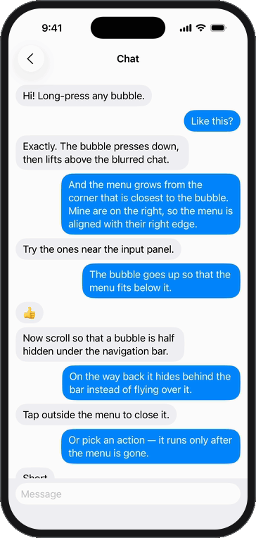
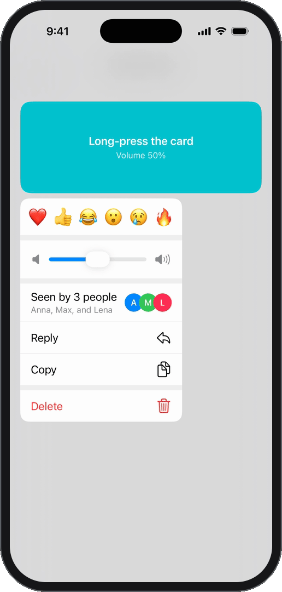
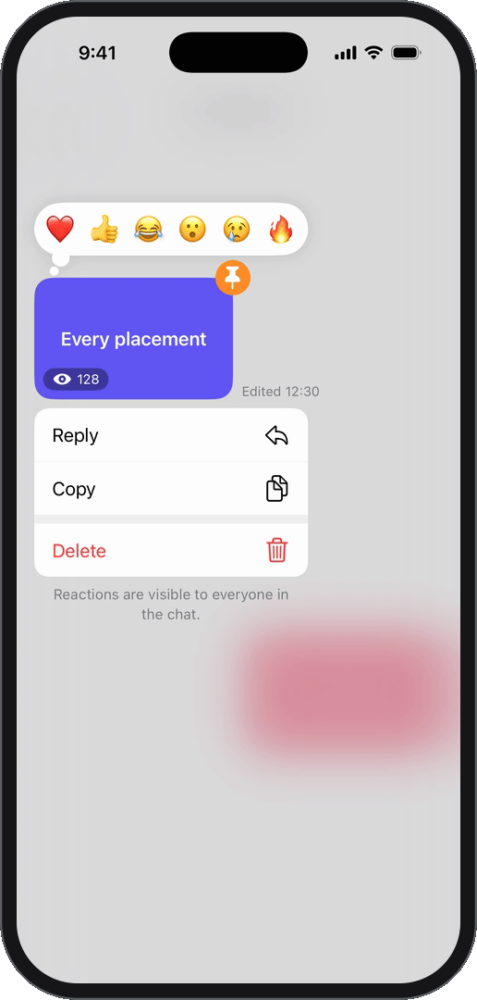
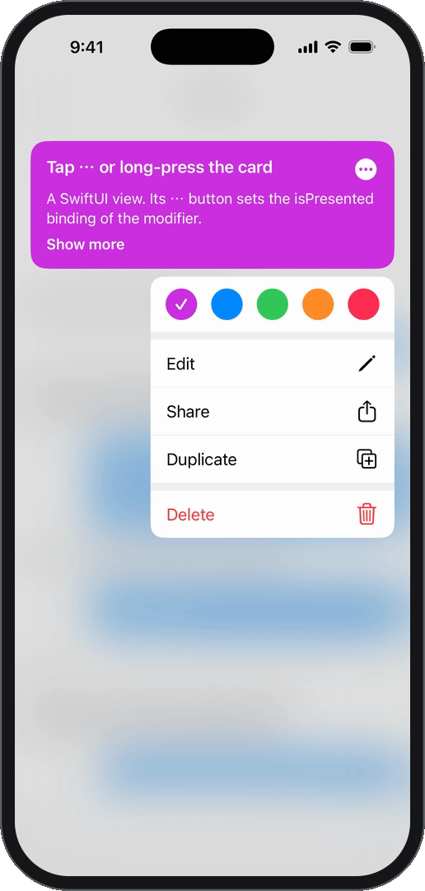
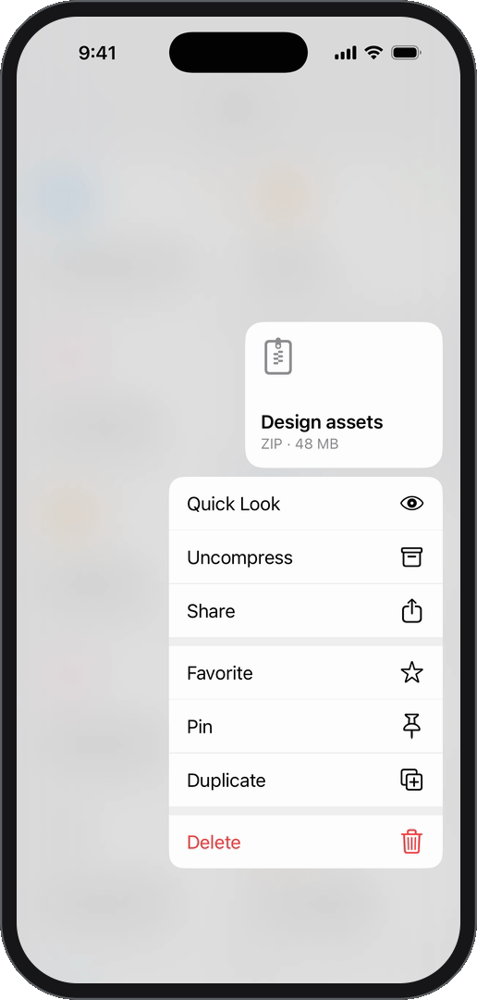
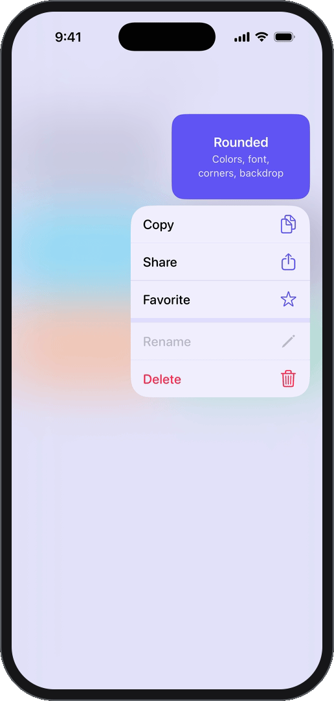
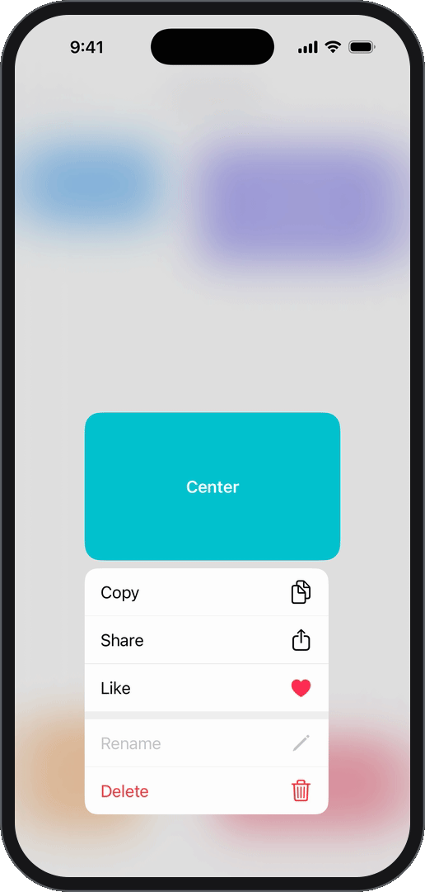

<div align="center">

# ContextMenuKit

**A custom context menu for any `UIView` or SwiftUI view.**<br>
The press-down, the lift and the blur of the system menu — with your own items, layout and style.




</div>

## Highlights

- **Feels like the system menu.** The view presses down, its preview lifts above a blurred backdrop and the menu
  grows from the corner closest to it. On the way back the preview can hide behind the bars instead of flying over them.
- **A live preview when you need one.** The preview is a snapshot by default, or your own view that stays live:
  select and copy a part of a message right in the lifted bubble.
- **Your own views in the menu.** Reactions, sliders, rows with avatars — interactive or selectable like an action.
- **Accessories around it.** Reactions above a message, a badge on the preview, a hint below the menu.
- **UIKit and SwiftUI.** A `UIInteraction` for any `UIView`, a modifier with an `isPresented` binding for SwiftUI.
- **Any size, anywhere.** The preview moves to make room for the menu and stays clear of the safe area;
  content taller than the screen makes the overlay scroll.
- **Styled to your app.** Every color, font, size, timing and the haptic live in `ContextMenuStyle`
  and `ContextMenuAnimationSpec`.
- **No dependencies.** iOS 15+, no resources, no `UIApplication.shared`, works in app extensions.

<table>
  <tr>
    <td align="center" valign="top" width="33%">
      <picture>
        <source media="(prefers-color-scheme: dark)" srcset=".github/media/custom-items-dark.png">
        
      </picture>
      <br><b>Custom items</b>
      <br><sub>Your own views in the menu</sub>
    </td>
    <td align="center" valign="top" width="33%">
      <picture>
        <source media="(prefers-color-scheme: dark)" srcset=".github/media/accessories-dark.png">
        
      </picture>
      <br><b>Accessories</b>
      <br><sub>Around the preview and the menu</sub>
    </td>
    <td align="center" valign="top" width="33%">
      <picture>
        <source media="(prefers-color-scheme: dark)" srcset=".github/media/swiftui-dark.png">
        
      </picture>
      <br><b>SwiftUI</b>
      <br><sub>One modifier, the same builder</sub>
    </td>
  </tr>
  <tr>
    <td align="center" valign="top" width="33%">
      <picture>
        <source media="(prefers-color-scheme: dark)" srcset=".github/media/files-dark.png">
        
      </picture>
      <br><b>Sections and icons</b>
      <br><sub>Built-in icons for common actions</sub>
    </td>
    <td align="center" valign="top" width="33%">
      <picture>
        <source media="(prefers-color-scheme: dark)" srcset=".github/media/styles-dark.png">
        
      </picture>
      <br><b>Styles</b>
      <br><sub>Colors, fonts, corners, backdrop</sub>
    </td>
    <td align="center" valign="top" width="33%">
      <picture>
        <source media="(prefers-color-scheme: dark)" srcset=".github/media/free-views-dark.png">
        
      </picture>
      <br><b>Any view</b>
      <br><sub>Any size, anywhere on screen</sub>
    </td>
  </tr>
</table>

## Requirements

- iOS 15+. The SwiftUI modifier `contextMenuInteraction(...)` needs iOS 16.
- Xcode 16+. Your app may use either the Swift 5 or the Swift 6 language mode.

## Installation

In Xcode: **File → Add Package Dependencies…** and paste the repository URL. Or in `Package.swift`:

```swift
.package(url: "https://github.com/sashchekam/ContextMenuKit", from: "0.1.0")
```

## Usage

```swift
import ContextMenuKit

final class MessageCell: UICollectionViewCell, ContextMenuInteractionDelegate {
    override init(frame: CGRect) {
        super.init(frame: frame)
        bubbleView.addInteraction(ContextMenuInteraction(delegate: self))
    }

    func contextMenuInteraction(
        _ interaction: ContextMenuInteraction,
        configurationAt location: CGPoint
    ) -> ContextMenuConfiguration? {
        ContextMenuConfiguration(
            menu: ContextMenu {
                ContextMenuAction(title: "Copy", image: .system(.copy)) { /* … */ }
                ContextMenuAction(title: "Delete", image: .system(.delete), isDestructive: true) { /* … */ }
            },
            alignment: .trailing
        )
    }
}
```

- `ContextMenu { … }` and `ContextMenuSection { … }` are result builders: group actions into sections and use
  `if`, `switch` and `for` inside. Actions outside of a section form one section.
- Icons: `.system(.delete)` picks an SF Symbol for a common action without a symbol name, `.custom(image)` takes
  any `UIImage`.
- `interaction.presentMenu()` shows the menu without a press, e.g. from a "More" button.
- `ContextMenuClipping.rect` keeps the preview from flying over navigation bars on its way back.
- `ContextMenuStyle` and `ContextMenuAnimationSpec` hold every color, size and timing.
- `animationSpec.hapticFeedback` is the haptic of the lift: `.impact(.soft, intensity: 0.7)`, `.selection`,
  or `nil` to turn it off. A rigid impact by default.

### Live preview

By default the menu lifts a snapshot of the view. `preview: .view { … }` lifts your own view instead: it stays live
and gets touches. In a chat, the lifted bubble can let the user select a part of a message and copy it:

```swift
ContextMenuConfiguration(
    menu: menu,
    // The same bubble as in the cell, with a selectable UITextView for the text.
    preview: .view { _ in
        MessageBubbleView(message: message, isTextSelectable: true)
    },
    alignment: message.isOutgoing ? .trailing : .leading
)
```

- The view is as large as the source view and sits right over it, so make it look the same: the source view is
  hidden while the menu is shown, and the preview fades into it once it has landed.
- A tap on the view doesn't dismiss the menu; a view with `isUserInteractionEnabled = false` lets the tap through.
  Close the menu from the view with `menu.dismiss(performing:)`.
- When the dismissal starts, the preview resigns the first responder: the text selection and its edit menu go away
  before the preview flies back.
- SwiftUI views work too: `preview: .view { _ in MessageBubble(message) }`, and the modifier takes `preview:`.

### Custom items

`ContextMenuCustomItem` puts your own view into the menu, next to actions and in the same builders.

```swift
ContextMenu {
    ContextMenuSection {
        // Interactive: the view handles touches itself and closes the menu through the proxy.
        ContextMenuCustomItem { menu in
            ReactionsBar(reactions: reactions) { reaction in
                menu.dismiss { react(with: reaction) }
            }
        }
    }
    // Selectable: the whole row highlights and works like an action, the view only draws it.
    ContextMenuCustomItem {
        showReadReceipts()
    } view: {
        ReadReceiptsRow(readers: readers)
    }
    ContextMenuAction(title: "Reply", image: .system(.reply)) { /* … */ }
}
```

- Handlers, both the selectable item's and the one passed to `menu.dismiss`, run after the dismissal animation,
  like action handlers.
- The view is as wide as the menu. Its height comes from Auto Layout (or `sizeThatFits(_:)` for frame layout);
  pass `height:` to set it explicitly. Keep the view's background clear.
- SwiftUI views work too: `ContextMenuCustomItem { menu in MyView(menu: menu) }`,
  `ContextMenuCustomItem { … } content: { MyRow() }`. With the SwiftUI modifier they get its environment.

### Accessories

`ContextMenuAccessory` puts your own view next to the preview or the menu, outside of the menu list:
reactions above a message, a hint below the menu, a badge on the preview.

```swift
ContextMenuConfiguration(
    menu: menu,
    accessories: [
        // Reactions above the message, on the side of the menu; they stay on screen above a tall message.
        ContextMenuAccessory(placement: .above(.preview), scrollBehavior: .staysVisible) { menu in
            ReactionsBar(reactions: reactions) { reaction in
                menu.dismiss { react(with: reaction) }
            }
        },
        // A hint as wide as the menu, centered below it, that only fades in.
        ContextMenuAccessory(
            placement: .below(.menu, alignment: .center),
            size: ContextMenuAccessory.Size(width: .matchingTarget),
            transition: .opacity
        ) { _ in
            HintLabel("Reactions are visible to everyone in the chat.")
        }
    ],
    alignment: message.isOutgoing ? .trailing : .leading
)
```

- **Placement.** `.above`, `.below`, `.beside` or `.overlay` the preview or the menu, aligned with an edge,
  the center or the edge of the menu (`.menuEdge`, follows `.automatic` alignment). Any other relation:
  `ContextMenuAccessory.Placement(target:targetAnchor:accessoryAnchor:)` pins a unit point of the accessory to
  a unit point of the target. `spacing` and `offset` fine-tune it.
- **Layout.** The preview moves down to make room for whatever sticks out above it, and the menu goes below
  everything attached to the preview. Accessories keep the inset from the screen edges.
- **Size.** Per dimension: `.fitting` (Auto Layout or `sizeThatFits(_:)`), `.fixed(_:)` or `.matchingTarget`.
- **Transition.** `.scale` grows out of the point it is attached to, `.opacity` fades, `.identity` flies with
  its target; or set the collapsed scale, alpha, anchor point and offset yourself.
- **Scrolling.** For a preview taller than the screen, `.staysVisible` keeps the accessory on screen.
- **Touches.** A tap on an accessory doesn't dismiss the menu; a view with `isUserInteractionEnabled = false`
  lets the tap through. Close the menu with `menu.dismiss(performing:)`.
- **Lifecycle.** A `UIView` that adopts `ContextMenuAccessoryView` learns where the preview and the menu end up
  (to point a tail at the preview) and when the menu appears and disappears (to run its own animations).
- A menu may have no items at all: `ContextMenuConfiguration(accessories: [reactions])` shows only the preview
  and the accessories.
- SwiftUI views work too: `ContextMenuAccessory { menu in Reactions(menu: menu) }`, and the modifier takes
  `accessories:`.

### SwiftUI

The modifier needs iOS 16. On iOS 15, SwiftUI views still work as custom items and accessories
of a menu presented by `ContextMenuInteraction`.

```swift
import ContextMenuKit
import SwiftUI

struct MessageRow: View {
    let message: Message
    @State private var isMenuPresented = false

    var body: some View {
        MessageBubble(message)
            .contextMenuInteraction(
                isPresented: $isMenuPresented,
                alignment: message.isOutgoing ? .trailing : .leading
            ) {
                ContextMenuAction(title: "Copy", image: .system(.copy)) { /* … */ }
                ContextMenuSection {
                    ContextMenuAction(title: "Delete", image: .system(.delete), isDestructive: true) { /* … */ }
                }
            }
    }
}
```

- The modifier takes the same builder as `ContextMenu { … }` and the same options as `ContextMenuConfiguration`,
  the preview and accessories included.
  The menu is built right before it is shown.
- `isPresented` is optional: set it to `true` to show the menu without a press, e.g. from a "More" button.
  It turns `false` once the menu is dismissed.
- The view is hosted in its own `UIHostingController`. It gets the environment (environment objects included),
  and its size follows its content. Preferences such as `navigationTitle` don't leave it, and a `withAnimation`
  transaction from outside doesn't animate it: apply such modifiers outside, use `animation(_:value:)` inside.
- `ContextMenu` as a type name is ambiguous with the deprecated `SwiftUI.ContextMenu`: write
  `ContextMenuKit.ContextMenu`. Expressions like `ContextMenu { … }` compile as is.

## Example app

`Example/ContextMenuKitExample.xcodeproj` has a screen for every feature: a chat with selectable text in the lifted
bubble, a file grid, free views
of different sizes, a view and a menu taller than the screen, a "More" button, custom items, accessories, styles,
a log of delegate calls and SwiftUI. Open it and press Cmd+R.

## Development

Open `Example/ContextMenuKitExample.xcodeproj`: Cmd+R runs the example app, Cmd+U runs the package tests.
Snapshot references are recorded on iPhone 17 Pro with iOS 26.0, so run the tests on that simulator.

The same from the command line:

```sh
make test        # package tests
make example     # build the example app
make lint        # SwiftLint
```

## License

ContextMenuKit is available under the MIT license. See [LICENSE](LICENSE).
